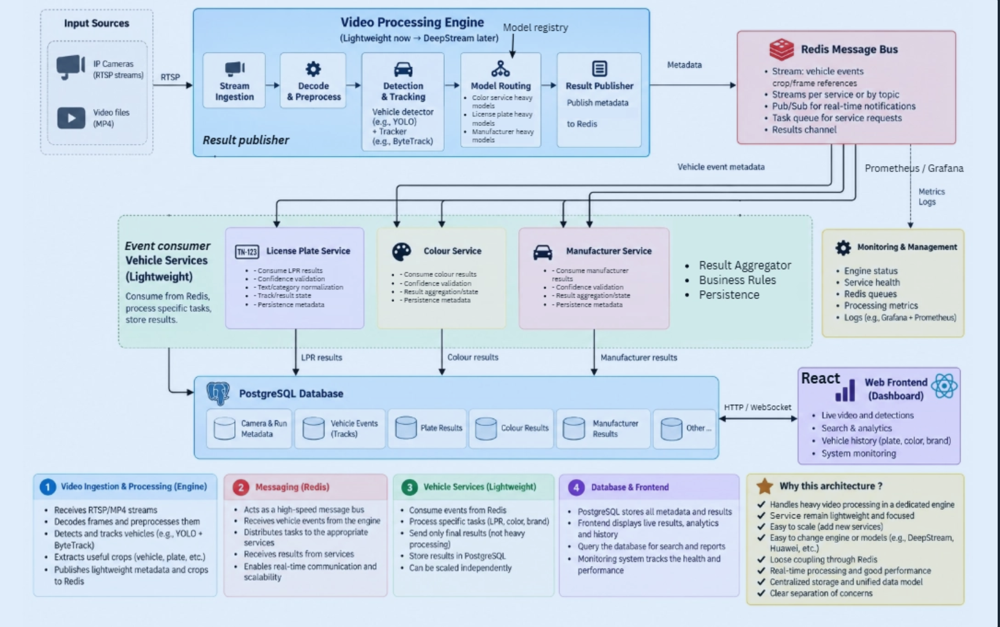

<div align="center">


# Any Vehicle · Waycon

**Big-picture vehicle intelligence. Small GPU footprint.**

From passing vehicles to searchable insights — one shared pipeline, five recognition outputs.


Recorded video · RTSP cameras · Plate recognition · Vehicle attributes

**Developed by Mohamed Mdhaffar and Mohamed Aziz Saoudi.**

[Architecture](#system-architecture) · [Evaluation](#evaluation-highlights) ·
[Setup](#1-set-up-redis) · [Models](#3-download-and-place-recognition-models) ·
[Technical report](waycon_pipeline_technical_report.md) · [License](LICENSE.md)

</div>

---

## What the solution does

Any Vehicle is the vehicle analytics console for the Waycon pipeline. Upload a
recording, select a server-local video or connect an RTSP camera. The shared
engine follows vehicle tracks, selects recognition crops and produces structured
results for review and delivery to PostgreSQL.

| Capability | Output |
|---|---|
| Vehicle detection and tracking | Vehicle identities and frame-associated observations |
| License plate recognition | Plate category and validated registration number, or an explicit unresolved outcome |
| Local LFM recognition | Manufacturer, exterior colour and vehicle body type |
| Evidence and evaluation | Selected crops, previews, manual reviews and CSV exports |
| Delivery and operations | Redis handoffs, database delivery state and controlled Stop |

## More intelligence. Less GPU memory.

**Follow the vehicle. Read the plate. Recognize the details.** Any Vehicle brings
plate numbers, plate categories, manufacturer, colour and body type into a single
workspace, with selected image evidence behind the results.

- **Local vision-language inference with llama.cpp.** LFM2.5-VL-450M runs through
  the CUDA-enabled `llama-cpp-python` binding, using a GGUF model and its vision
  projector. One shared LFM inference provides manufacturer, colour and body type.
- **Under 2 GB of GPU memory.** A compact GPU
  footprint makes efficient local deployment a key project highlight.
- **A complete workflow in one console.** Recorded video and RTSP input,
  recognition, evidence review, CSV export and PostgreSQL delivery work through
  the same pipeline

## System architecture



*Architecture supplied by the project team. The diagram presents the engine,
Redis, logical recognition services, PostgreSQL and frontend as the main
responsibilities.*

1. **Input and orchestration.** The Django API admits a video or camera run and
   launches an owned worker. The engine receives decoded frames with frame
   receipts; the RTSP path also uses a separate decoder process.
2. **Shared video engine.** Vehicle detection and ByteTrack establish vehicle
   lifetimes. The engine selects crops and executes plate detection, category
   recognition, registration OCR and local LFM attributes. Heavy models and pixels
   remain inside the engine boundary.
3. **Redis message transport.** Settled scalar evidence travels through Redis
   Streams and consumer groups. The recognition worker validates and aggregates
   that evidence, then publishes database-delivery messages. Image evidence stays
   in local files; Redis does not transport decoded image arrays.
4. **DB1 and PostgreSQL.** DB1 is the project's analytical-data contract. A
   separate CPU delivery process validates rows, resolves registrations and
   commits vehicle and recognition facts to PostgreSQL before acknowledging
   successful Redis deliveries. The current fixture path provisions isolated
   PostgreSQL databases; this does not establish production deployment approval.
5. **Console and review.** React calls Django over HTTP for status, previews,
   crops, controls and evaluation. The current UI polls the API; it does not
   connect directly to PostgreSQL. Local SQLite stores hold evaluation/review
   history and the delivery outbox, separately from PostgreSQL analytical facts.

> **Implementation boundary:** the plate, manufacturer, colour and vehicle-type
> responsibilities are logical services inside the shared recognition worker,
> rather than separately deployed HTTP microservices. LFM provides the three
> vehicle attributes in one shared inference. DeepStream, independent service
> scaling, Redis Pub/Sub notifications, WebSocket delivery and Prometheus/Grafana
> in the illustration are architectural extensions, not active capabilities
> verified by this README.

See the [technical report](waycon_pipeline_technical_report.md) for the detailed
process boundaries, message contracts, database relationships and failure paths.
The report describes the checkout inspected on **25 November 2026**, before the
subsequent workspace relocation and asset-path cleanup; its old filesystem paths
are historical references. Use the setup/model paths in this README for this
workspace.

## Evaluation highlights

The technical report analyzes `waycon_video_12_fusion.csv`: **557 manually reviewed
field predictions** from two runs, representing 128 distinct run/vehicle-lifetime
pairs. Recomputing the source CSV for this README confirmed **518 correct and 39
incorrect predictions**, and agreement between `is_correct` and `review_verdict`
on all 557 rows.

<div align="center">


</div>

| Reviewed output | Correct | Incorrect | Total | Accuracy |
|---|---:|---:|---:|---:|
| Plate number | 102 | 0 | 102 | **100.00%** |
| Vehicle type | 118 | 1 | 119 | **99.16%** |
| Colour | 113 | 5 | 118 | **95.76%** |
| Plate category | 101 | 18 | 119 | **84.87%** |
| Manufacturer | 84 | 15 | 99 | **84.85%** |
| **Overall** | **518** | **39** | **557** | **93.00%** |

| Evaluated video | Run ID | Correct / reviewed predictions | Accuracy |
|---|---|---:|---:|
| Video 12 · Part 1 | `75fd4916-52c0-4a78-8c66-80c558ac94b1` | 212 / 230 | 92.17% |
| Video 12 · Part 2 | `e4b3a022-5531-4fc8-ac86-c24fddc6b185` | 306 / 327 | 93.58% |

> **How to read these results:** the denominator is reviewed field predictions,
> not all vehicles or all visible plates. The 100% plate-number result means all
> 102 reviewed number predictions were marked correct; it does not measure plate
> detection recall or end-to-end reading coverage. Manufacturer and plate
> category account for 33 of the 39 reviewed errors. Annotation inconsistencies
> and missing correction labels remain documented in the report. These two
> videos are different inputs, not a controlled before/after experiment, and
> neither historical run is pinned to a recoverable exact implementation revision.

These are historical evaluation results, not a new benchmark of the current
checkout or proof of accuracy changes from later fixes. Read the
[full methodology, confusion analysis and limitations](waycon_pipeline_technical_report.md#5-evaluation-methodology-and-results)
before drawing deployment conclusions.

---

## Setup and usage

This guide covers Redis, a fresh Python environment, consolidated Python
dependencies, the bundled LFM runtime wheel and recognition model placement.
CUDA/driver, Node.js and PostgreSQL setup instructions remain to be completed.

The commands below assume Linux. Run them from the directory containing this
README (`waycon-main/`). All project paths are relative to that directory:

```text
waycon-main/
├── requirements.txt
├── pipeline/
├── redis-8.2.11/
└── wheel/
    └── llama_cpp_python-0.4.6-cp311-cp311-linux_x86_64.whl
```

## 1. Set up Redis

Waycon needs the Redis server executable to exchange recognition evidence and
database-delivery messages. The console starts and stops its own private Redis
instance during analysis; you do not need to start a separate Redis service.

You need `wget`, `tar`, GNU Make and a C compiler/build toolchain to complete
these steps.

### Download and extract

Download Redis 8.2.11 from the official release server:

```bash
wget https://download.redis.io/releases/redis-8.2.11.tar.gz
tar -xzf redis-8.2.11.tar.gz
```

If this version is already extracted and built in this workspace, skip directly
to the environment-variable step.

### Build the server

```bash
make -C redis-8.2.11 redis-server
```

Verify the executable:

```bash
./redis-8.2.11/src/redis-server --version
```

The output should identify Redis version `8.2.11`. The executable is now located
at:

```text
redis-8.2.11/src/redis-server
```

### Set the environment variable

From `waycon-main/`, in the terminal where you will launch Waycon, run:

```bash
export T1_REDIS_SERVER="$PWD/redis-8.2.11/src/redis-server"
```

Verify the selected path:

```bash
"$T1_REDIS_SERVER" --version
```

`$PWD` resolves the workspace location so the variable remains valid if you change
directories. No machine-specific path is hard-coded. The export applies to the
current terminal and programs launched from it. Repeat it from `waycon-main/`
when opening a new terminal or after relocating the workspace.

The explicit `T1_REDIS_SERVER` environment variable takes precedence over the
`redis_server` setting in `~/.config/waycon/console.json`.

## 2. Create a Python environment and install requirements

Use **CPython 3.11 on Linux x86-64** for compatibility with the supplied CUDA
LFM wheel. Create a fresh Conda environment; no pre-existing project environment
is required:

```bash
conda create -n waycon -c conda-forge python=3.11 pip libstdcxx-ng libgcc-ng
conda activate waycon
python --version
export T1_CONSOLE_PYTHON="$(command -v python)"
```

The interpreter export makes the launcher use this environment instead of its
historical interpreter default or a different interpreter in private configuration.
Repeat activation and this export in each new launch terminal. The C++ runtime
packages support the native CUDA binding; they do not install an NVIDIA driver.

### Install requirements.txt

With the `waycon` environment active, run the following from `waycon-main/`
(the directory containing this README and `requirements.txt`):

```bash
python -m pip install -r requirements.txt
python -m pip check
```

The installation command installs the Python dependencies into the active
environment. `pip check` verifies the installed packages' dependency requirements;
it should report `No broken requirements found.` before you continue.
Run from this directory because the requirements include a relative wheel path.

`requirements.txt` merges the two project dependency lists, removes duplicates,
and includes the bundled wheel through its relative path. It excludes the legacy FastAPI server packages because the console uses Django.
It retains TensorRT/export and review-agent packages, so installation includes large
packages beyond those needed by the console alone. Redis's own validation tools
and the vendored DINOv3 training/development requirements are excluded: they are
separate upstream tooling, not console installation requirements. Keep the original
lists as historical references; use this root file for the documented setup.

Two conflicting pins were resolved explicitly: GPU Paddle replaces CPU Paddle,
and NumPy is pinned to `2.3.2` because the bundled LFM wheel requires
`numpy<=2.3.2`, whereas the original lists selected `2.3.5`. The other project
version constraints are preserved. This list is not a complete transitive lockfile.

### Verify the bundled LFM wheel

Manufacturer, colour and body-type recognition require the supplied CUDA-enabled
`llama-cpp-python` build, whose binding files match the revision checked by Waycon.
The requirements file installs it. If another build with version `0.4.6` was already
installed, explicitly replace it with the bundled build:

```bash
python -m pip install --force-reinstall --no-deps ./wheel/llama_cpp_python-0.4.6-cp311-cp311-linux_x86_64.whl
python -m pip check
python -c "from importlib.metadata import version; print(version('llama-cpp-python'))"
```

`--no-deps` is used only for this replacement after the requirements installation
has supplied the wheel's dependencies. The version output should be `0.4.6`;
version alone does not verify the binding revision or CUDA execution. Console
preflight checks native model construction. NVIDIA drivers and model assets must
be installed separately.

The consolidated list has been checked for duplicate declarations and the wheel's
NumPy constraint. Installation into a fresh environment and GPU inference must
still be verified on the target machine; the existing environment was not changed.

## 3. Download and place recognition models

The package layout is described in
[`pipeline/vehicle/recognition/README.md`](pipeline/vehicle/recognition/README.md).
The destinations below were checked against `recognition/config.py`, the LFM
asset resolver and `plate/license_plate_plugin/configuration/local_reproduction.json`.
All commands in this section run from `waycon-main/`, with the Python environment
activated. Do not download again if the correct assets are already present.

Create the destination directories:

```bash
mkdir -p pipeline/vehicle/recognition/attributes/models
mkdir -p pipeline/vehicle/recognition/plate/models
mkdir -p pipeline/vehicle/recognition/plate/license_plate_plugin/assets/models/dinov3
mkdir -p pipeline/vehicle/recognition/plate/license_plate_plugin/assets/models/arabic_PP-OCRv5_mobile_rec
```

### Model inventory

Paths in this table are relative to `pipeline/vehicle/recognition/`.

| Component | Required destination | Source |
|---|---|---|
| Vehicle detector | `attributes/models/vehicle_yolo26.pt` | Project-trained checkpoint; obtain the exact file from the project maintainer or a working deployment |
| LFM attribute model | `attributes/models/LFM2.5-VL-450M-BF16.gguf` | LiquidAI's GGUF repository, command below |
| LFM vision projector | `attributes/models/mmproj-LFM2.5-VL-450m-BF16.gguf` | Same LiquidAI repository; both files are required |
| Plate detector | `plate/models/plate_detector.onnx` | Open Image Models' YOLOv9-t **640** end-to-end checkpoint, renamed on download |
| Tunis word detector | `plate/models/tounes_word_detector.pt` | Project-trained checkpoint; obtain the exact file from the project maintainer or a working deployment |
| Registration OCR | `plate/models/PP-OCRv6_medium_rec/` | PaddlePaddle's model repository |
| Arabic category OCR | `plate/license_plate_plugin/assets/models/arabic_PP-OCRv5_mobile_rec/` | PaddlePaddle's model repository |
| Visual category encoder | `plate/license_plate_plugin/assets/models/dinov3/dinov3_vits16_pretrain_lvd1689m-08c60483.pth` | Meta DINOv3 access/download process |
| Category reference embeddings | `plate/license_plate_plugin/assets/reference_index/reference_r2.npz` and `reference_r2.json` | Project-specific matched reference bundle; preserve or restore it |

Colour, manufacturer and vehicle body type share the LFM inference result. They
do not require three separate models. ByteTrack uses the existing YAML files in
`attributes/trackers/` and `plate/trackers/`; there is no separate tracking weight
file to download.

### LFM model and vision projector

Download these exact filenames from the
[official LiquidAI GGUF repository](https://huggingface.co/LiquidAI/LFM2.5-VL-450M-GGUF/tree/main):

```bash
wget -O pipeline/vehicle/recognition/attributes/models/LFM2.5-VL-450M-BF16.gguf \
  'https://huggingface.co/LiquidAI/LFM2.5-VL-450M-GGUF/resolve/main/LFM2.5-VL-450M-BF16.gguf'
wget -O pipeline/vehicle/recognition/attributes/models/mmproj-LFM2.5-VL-450m-BF16.gguf \
  'https://huggingface.co/LiquidAI/LFM2.5-VL-450M-GGUF/resolve/main/mmproj-LFM2.5-VL-450m-BF16.gguf'
```

The lowercase `m` in the projector filename is intentional. Retain
`attributes/models/gguf-assets.sha256`; check the files against it:

```bash
(cd pipeline/vehicle/recognition/attributes/models && sha256sum -c gguf-assets.sha256)
```

The optional Hugging Face directory `attributes/models/LFM2.5-VL-450M/` is not
required by the normal llama.cpp backend. If explicitly using the alternative
Hugging Face backend, obtain that complete directory from
[LiquidAI/LFM2.5-VL-450M](https://huggingface.co/LiquidAI/LFM2.5-VL-450M)
and verify its separate backend/dependency requirements; it does not replace the
GGUF files for the default backend.

### CUDA ONNX plate detector

The [Open Image Models release](https://github.com/ankandrew/open-image-models/releases/tag/assets)
contains several input resolutions. Download the exact **t-640** model; the
runtime checks its hash and input shape:

```bash
wget -O pipeline/vehicle/recognition/plate/models/plate_detector.onnx \
  'https://github.com/ankandrew/open-image-models/releases/download/assets/yolo-v9-t-640-license-plates-end2end.onnx'
printf '%s  %s\n' \
  'c3c1026ca7d0585dd88084d68182dd897113712fa734ae1557ca70174440c076' \
  'pipeline/vehicle/recognition/plate/models/plate_detector.onnx' | sha256sum -c -
```

### Registration OCR and Arabic category OCR

Download all three inference files for each OCR model. The weights alone are not
sufficient; the graph and configuration include information needed by Paddle.
Sources: [registration OCR](https://huggingface.co/PaddlePaddle/PP-OCRv6_medium_rec/tree/main)
and [Arabic category OCR](https://huggingface.co/PaddlePaddle/arabic_PP-OCRv5_mobile_rec/tree/main).

```bash
mkdir -p pipeline/vehicle/recognition/plate/models/PP-OCRv6_medium_rec
for model_file in inference.json inference.pdiparams inference.yml; do
  wget -O "pipeline/vehicle/recognition/plate/models/PP-OCRv6_medium_rec/$model_file" \
    "https://huggingface.co/PaddlePaddle/PP-OCRv6_medium_rec/resolve/main/$model_file" || break
done

for model_file in inference.json inference.pdiparams inference.yml; do
  wget -O "pipeline/vehicle/recognition/plate/license_plate_plugin/assets/models/arabic_PP-OCRv5_mobile_rec/$model_file" \
    "https://huggingface.co/PaddlePaddle/arabic_PP-OCRv5_mobile_rec/resolve/main/$model_file" || break
done
```

These links track the upstream `main` revisions. For reproducible deployments,
archive the verified downloaded files and record their hashes/revisions. Do not
silently replace an evaluated OCR bundle with a newer upstream version.

### DINOv3 checkpoint and source

Follow the model access instructions in the
[official DINOv3 repository](https://github.com/facebookresearch/dinov3#pretrained-models).
Meta provides the weight download URLs after access is approved. Select the
**ViT-S/16 LVD-1689M** checkpoint with the filename shown below. The runtime uses
its native `.pth` weights, not a Transformers-format substitute.

Paste the approved download URL when prompted:

```bash
read -r -p 'DINOv3 ViT-S/16 download URL: ' DINOV3_DOWNLOAD_URL
wget -O pipeline/vehicle/recognition/plate/license_plate_plugin/assets/models/dinov3/dinov3_vits16_pretrain_lvd1689m-08c60483.pth \
  "$DINOV3_DOWNLOAD_URL"
unset DINOV3_DOWNLOAD_URL
printf '%s  %s\n' \
  '08c60483bc63c04f533611e34bf70b120eedb7240f469bc16e9e20bf344b941d' \
  'pipeline/vehicle/recognition/plate/license_plate_plugin/assets/models/dinov3/dinov3_vits16_pretrain_lvd1689m-08c60483.pth' | sha256sum -c -
```

Keep the bundled source checkout at
`pipeline/vehicle/recognition/plate/license_plate_plugin/assets/vendor/dinov3/`.
If it is missing, restore the source revision recorded by the current reference
index (run these commands only when that destination does not exist):

```bash
git clone https://github.com/facebookresearch/dinov3.git \
  pipeline/vehicle/recognition/plate/license_plate_plugin/assets/vendor/dinov3
git -C pipeline/vehicle/recognition/plate/license_plate_plugin/assets/vendor/dinov3 \
  checkout 6876159a11b4df116f30f667f8c9888617df0751
```

Changing the source revision, weights or preprocessing can invalidate the saved
reference index. Respect the upstream model license and access terms.

### Project-specific detectors and category reference bundle

No verified public download URL is recorded for `vehicle_yolo26.pt`,
`tounes_word_detector.pt`, or the category reference bundle. Obtain them from the
project maintainer or copy them from a known working deployment. The vehicle
checkpoint is a trained YOLO26m model; the marker checkpoint is a trained YOLO26n
model. Generic upstream YOLO weights are not equivalent replacements.

For example, place the supplied assets into a local `model-backup/` directory,
then copy them to the destinations below:

```bash
cp model-backup/vehicle_yolo26.pt pipeline/vehicle/recognition/attributes/models/
cp model-backup/tounes_word_detector.pt pipeline/vehicle/recognition/plate/models/
mkdir -p pipeline/vehicle/recognition/plate/license_plate_plugin/assets/reference_index
cp model-backup/reference_index/reference_r2.npz \
  model-backup/reference_index/reference_r2.json \
  pipeline/vehicle/recognition/plate/license_plate_plugin/assets/reference_index/
```

Keep `plate/license_plate_plugin/assets/references/manifest.json` with its matching
index. If rebuilding embeddings, also restore the exact `references/images/`
files listed by that manifest. The eight reference images are absent from the
workspace inspected for this guide; the existing precomputed index can be loaded
without them, but rebuilding it requires restoring them. Do not substitute
arbitrary plate pictures for the reviewed reference collection.

The two checkpoint hashes in the inspected deployment are:

```text
vehicle_yolo26.pt       f0574db3428cf12af8c07c40aaa6e042f9cf830f1b22d2ee9ea4dcd370acfc29
tounes_word_detector.pt f8956bd78992661bf5a88905f355b48168c0e5d643c3f7635795cfc266d11293
```

### Verify placement and startup

Inspect the resolved paths without loading models:

```bash
(cd pipeline && python -B - <<'PY'
from vehicle.recognition.config import paths
from vehicle.recognition.attributes.manufacturer.gguf_assets import resolve_gguf_assets
for name, path in paths().items():
    print(name, path, 'OK' if path.exists() else 'MISSING')
print('LFM model/projector:', resolve_gguf_assets())
PY
)
```

Environment overrides can select different assets. The default model paths above
are package-relative; do not move assets back into the removed Django apps.
Launch the console after the system dependencies are configured. Its preflight
performs the native model-loading checks; file presence alone does not prove GPU
inference works. This guide's download URLs were checked against upstream listings,
but the large model downloads were not rerun during the documentation update.

## 4. Launch the console

After the remaining project dependencies are configured, launch the console from
the same terminal where you activated `waycon` and exported `T1_REDIS_SERVER`
and `T1_CONSOLE_PYTHON`:

```bash
./pipeline/scripts/run_vehicle_console.sh
```

Open the frontend URL printed by the launcher. Use `Ctrl+C` in the launcher
terminal to request an owned shutdown.

If startup reports `Missing redis-server executable`, repeat the export and check
that `"$T1_REDIS_SERVER" --version` succeeds in that same terminal.

## 5. Other dependencies

CUDA/driver compatibility, Node.js and PostgreSQL setup instructions
will be added here. Python dependencies do not install the Redis server, Node.js,
PostgreSQL server or model assets. These steps alone do not complete installation.


---

## Authors and license

This project was developed by **Mohamed Mdhaffar** and **Mohamed Aziz Saoudi**.

**Copyright © 2026 Mohamed Mdhaffar and Mohamed Aziz Saoudi. All rights reserved.**
Reuse of the project's original contributions requires permission, subject to
applicable law. See [LICENSE.md](LICENSE.md). Third-party libraries, model weights
and assets retain their own licenses; this notice does not replace them.
