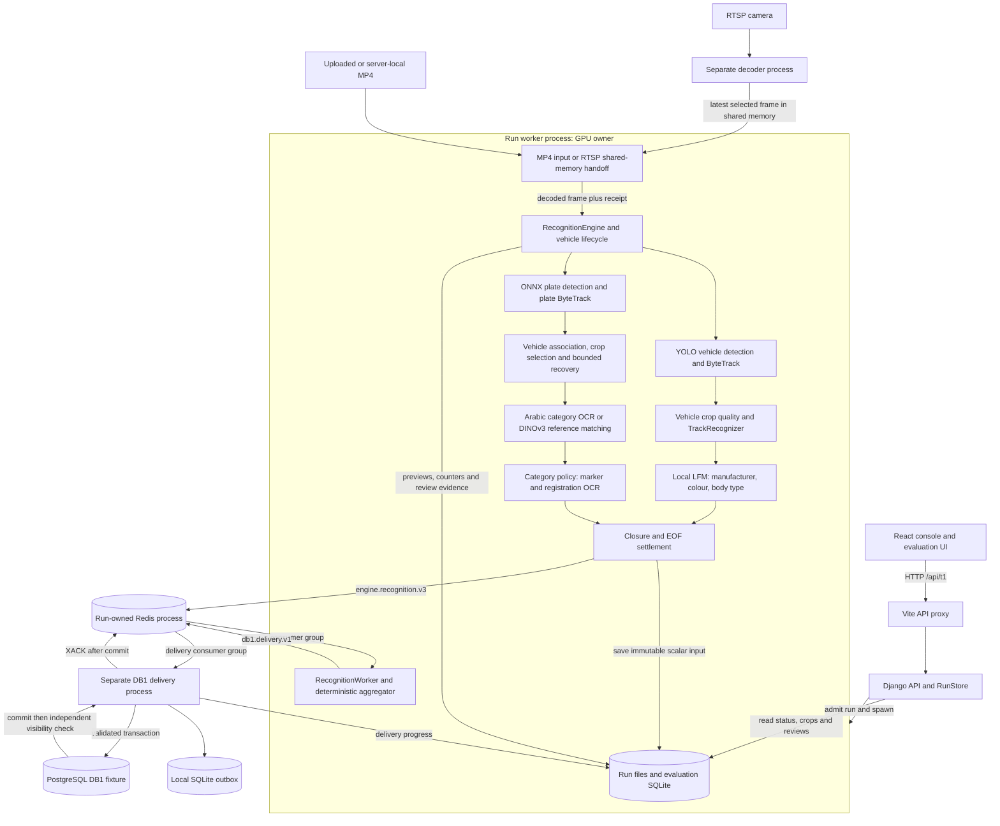
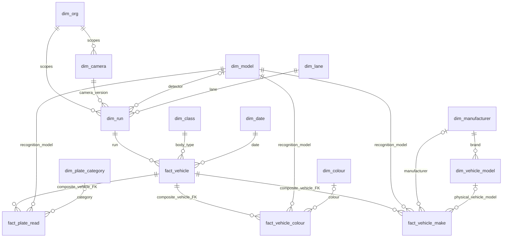

# Waycon Vehicle Analytics Pipeline — Technical Report

**Audience:** engineering supervisors and developers  
**Review date:** 25 November 2026  
**Repository:** `aziz/pipeline`; inspected HEAD `f708dde`  
**Primary evaluation:** `waycon_video_12_fusion.csv`, 557 manually reviewed predictions from two runs

## 1. Executive summary

Waycon turns recorded video or an RTSP camera stream into vehicle observations with manufacturer, body type, exterior colour, plate category and, when validation succeeds, a registration number. A Django/React console controls a shared processing engine. The engine owns decoded pixels and GPU inference; Redis carries settled scalar evidence to aggregation and database delivery. DB1 is the project's supplied analytical-data contract, implemented against PostgreSQL through validated natural identifiers and tenant-scoped fact rows.

Direct recomputation of the primary CSV gives **518 correct predictions, 39 incorrect predictions and 557 reviewed predictions: 93.00% overall accuracy**. The weakest reviewed outputs are manufacturer, **84/99 (84.85%)**, and plate category, **101/119 (84.87%)**. Together they account for 33/39 errors (84.62%). Vehicle type and colour perform better on the reviewed subset. All 102 reviewed plate-number predictions are marked correct, but this does **not** establish plate detection recall, end-to-end number coverage, or correctness of every unreviewed reading.

| Evaluated output | Correct | Incorrect | Reviewed total | Accuracy |
|---|---:|---:|---:|---:|
| Plate number | 102 | 0 | 102 | 100.00% |
| Vehicle type | 118 | 1 | 119 | 99.16% |
| Colour | 113 | 5 | 118 | 95.76% |
| Plate category | 101 | 18 | 119 | 84.87% |
| Manufacturer | 84 | 15 | 99 | 84.85% |
| **Overall** | **518** | **39** | **557** | **93.00%** |

These are field-prediction counts, not counts of independent vehicles. The CSV represents 128 distinct run/lifetime pairs. Several fields share one LFM inference, and a vehicle can contribute more than one plate prediction. The CSV also contains annotation inconsistencies described in Section 6. This report preserves the supplied manual verdicts rather than silently repairing or excluding them.

The current implementation has credible engineering controls: explicit frame receipts, unique service track identities, bounded crop retention and recovery, deterministic aggregation, fenced Redis handoffs, and PostgreSQL commit before delivery acknowledgment. These mechanisms are verified in source. Saved records for the Part 2 run additionally report 107 committed vehicle deliveries and independent row visibility before acknowledgment. This report did not start inference, rerun failure tests, or query a live PostgreSQL server; retained records are evidence of that run, not a fresh operational audit.

## 2. Scope, evidence and implementation provenance

### 2.1 Evaluation artifact and run identification

The primary file is located outside the repository at `/home/intern/part-time/waycon_video_12_fusion.csv`. Its SHA-256 is:

```text
cfc8aa35391ddffcb7e7769e993b109295e7ae6b9a0e971a1ce4bdbc0c8fe9ee
```

The two source hashes in the CSV were checked against the actual local video files. They identify separate halves of Video 12:

| Run alias | Full `run_id` | Source verified by SHA-256 | CSV rows | Distinct reviewed lifetimes |
|---|---|---|---:|---:|
| R1 | `75fd4916-52c0-4a78-8c66-80c558ac94b1` | `Projet vidéo 12 - Part 1.mp4` | 230 | 54 |
| R2 | `e4b3a022-5531-4fc8-ac86-c24fddc6b185` | `Projet vidéo 12 - Part 2.mp4` | 327 | 74 |

R1 source SHA-256: `35cfbb832993965618549e5658cba2790dba19baa4ff6cb68d682c61ccb6c863`. R2: `40e929f4de139be9e6bc99e8ec02ded19213dec1b0100aae077eb4c5f5568943`. The CSV camera names are `console-<run_id>` and lifetime names are `<run_id>:<service_track_id>`. Frame indices and video timestamps identify selected evidence within each clip; they are not absolute capture dates.

R2's directory, `vehicle/media/t1-console/e4b3a022-5531-4fc8-ac86-c24fddc6b185/`, contains configuration, status, 107 immutable recognition bundles, decision traces, evaluation SQLite, crops and DB1 progress. It records completion at EOF, 5,151 decoded and analyzed frames, sampling interval 1, attributes enabled, no maximum-duration limit, and all cleanup flags true. The status timestamps span `2026-11-25T12:11:52.173761+00:00` to `2026-11-25T12:26:42.824382+00:00`; this is a recorded run interval, not a controlled throughput benchmark.

All 327 R2 CSV crop references resolve to saved `evaluation-images` files after translating their API URLs to the run directory. R1's original directory is absent from the current run root, so its 230 crop URLs cannot be resolved there. R1's source identity and exported predictions are verified; its exact runtime configuration, per-stage decisions and original implementation revision are not recoverable from this CSV alone. Neither CSV nor inspected R2 configuration pins a Git commit. Inspected HEAD therefore describes the **current implementation**, not a proven byte-for-byte snapshot of both evaluated runs.

### 2.2 Documentation versus current code

Repository Markdown was consulted, then checked against entry points and implementations. Several documents describe older or proposed paths:

| Source material | Description or historical scope | Current `/api/t1/` implementation |
|---|---|---|
| `README.md` | Standalone Django application APIs, usual port 8000 and optional agent configuration | Console launcher defaults to backend 8002 and frontend 5173; normal run worker selects `recognition_run` |
| `docs/system_architecture_report.md`, especially colour and manufacturer sections | HSV colour measurements, manufacturer dispatcher/lock registration and older Redis worker branches | Local LFM supplies all three attributes inside the shared recognition process |
| `docs/architecture/vehicle_component_ownership.md` | Migration inventory, earlier skeletons and model paths | Active imports are `vehicle.recognition.*`; old service directories also remain as asset/source locations |
| `docs/recognition_integration_progress_2026-11-24.md` | Progress and earlier verification results | Useful historical evidence, but not proof that its tests or reported runs describe this checkout or the fusion CSV |
| `docs/t1/db1_alignment.md`, `contracts/db1/README.md` | Supplied development contract and delivery boundaries | Remain useful contract references; development fixture success does not establish production DB1 approval |

The inspected category code retains the original NT-first arbitration, and the manufacturer prompt retains its Toyota example. The experimental complete-marker arbitration and long manufacturer candidate prompt discussed in earlier work are not active in this source. No accuracy improvement from those experiments is attributed to the fusion CSV. The current manufacturer registry includes Škoda and Peugeot but does not include Mahindra. [S1, S6, S8, S11]

## 3. System architecture

### 3.1 Actual process and data boundaries

“Service” in this report means a logical responsibility unless a separate process is explicitly stated. Plate detection, category recognition, registration OCR and LFM attribute recognition are **modules within one run worker**, not independently deployed HTTP microservices. The worker uses a single-thread plate executor and serialized native model access. Database delivery is separated into a CPU process. This is a modular shared-engine deployment with service boundaries suitable for later replacement, rather than a fully distributed recognition deployment. [S2, S3]



The two SQLite stores have different responsibilities: `evaluation.sqlite3` stores inspection evidence and human reviews; `outbox.sqlite` retains canonical database-delivery entries. Neither is the PostgreSQL analytical warehouse. Redis messages contain scalar evidence and identifiers, not decoded image arrays. Local PNG/JPEG files carry image evidence. [S3, S4, S9, S10]

| Component | Runtime boundary | Main responsibility and communication |
|---|---|---|
| React/Vite | Node development server and browser | Controls runs, serves previews and review/export UI; proxies API requests |
| Django API/RunStore | Python web-server process | Validates input, allocates run directory, admits one owned run, serves saved state and Stop |
| Native run host/engine | Separate Python worker, GPU lease | Owns frames, models, associations, queues, settlement and scalar publication |
| Plate executor | One thread inside run host | Runs complete plate recognition through the shared serialized model lane |
| RTSP decoder | Additional child process for RTSP only | FFmpeg/OpenCV decoding into bounded shared memory; reports counters and faults |
| Redis | Run-owned executable, private Unix socket | Streams, pending entries, consumer groups, journal state, ownership fences and repair |
| Aggregator | Object executed by run host | Deterministically converts settled scalar evidence to DB1 natural rows |
| DB1 host | Separate Python CPU process | Resolves fixture registrations, validates rows, commits PostgreSQL, then acknowledges Redis |
| PostgreSQL | Local PostgreSQL 16 server/fixture database | Dimension, fact and delivery-receipt persistence with row-level security |

The repository's console dependency file specifies the following runtime versions. These are declared requirements, not a recovered package inventory for both historical runs:

| Layer | Declared versions / constraint |
|---|---|
| API | Python 3.11; Django 5.2.17; Django REST Framework 3.18.1 |
| Frames and vehicle models | OpenCV 4.13.0.92; NumPy 2.3.5; Ultralytics 8.4.46; PyTorch 2.11.0+cu128 |
| Plate ONNX | ONNX Runtime GPU 1.25.1; open-image-models 0.6.0 |
| OCR | PaddleOCR 3.7.0; PaddlePaddle GPU 3.3.1; PaddleX 3.7.1 |
| Visual reference model | Local DINOv3 source/checkpoint; timm 1.0.25 |
| VLM | llama-cpp-python 0.4.6 plus audited binding-source revision checks |
| Transport/storage clients | redis-py 7.4.0; psycopg 3.3.4; PostgreSQL server constrained to version 16 |

Source: `vehicle/requirements-console.txt:1–29`, LFM runtime checks and the DB1 server probe. CUDA requirements concern the actual configured native providers; an environment name alone does not establish GPU execution.

### 3.2 Admission, input and identity

`scripts/run_vehicle_console.sh` selects the Python runtime and invokes `scripts/vehicle_console_launcher.py`. The launcher configures the backend/proxy ports, verifies prerequisites and starts or manages the owned console services. Default DB1 mode is `fixture`; `--console-only` explicitly omits PostgreSQL delivery. Health or readiness checks do not prove video inference or persistence. [S1]

`POST /api/t1/runs/` accepts MP4 upload/server-path selection or RTSP configuration, sampling and attribute settings. `RunStore` stages configuration and starts `scripts/vehicle_console_worker.py`; the ordinary worker delegates to `vehicle.common.recognition_run.run`. HTTP 202 means admission, not completion. The host obtains the GPU lease and constructs models before processing frames. A server-local path avoids copying a large upload but still undergoes file and video validation. [S1, S2]

MP4 uses a single OpenCV capture and cannot reopen/replay itself within the same input instance. Premature decode failure before the declared frame count is an error, distinct from EOF. Sampling skips inference on unselected frames while maintaining original indices. RTSP uses a separate bounded decoder, a latest-frame shared-memory slot and counters for sampling skips and overload drops. It prioritizes recent frames rather than an unbounded queue. The current RTSP input does **not** transparently reconnect; reconnection requires a new input/run/clock/engine context. Lifecycle support for an epoch change must not be mistaken for automatic camera recovery. [S3]

Every processed packet carries original frame index, media presentation time and paired UTC/monotonic receipt information. The lifecycle allocator separates raw tracker IDs from run-scoped service IDs, tracks epochs/lifetimes, and closes observations on track loss, scene cut, reset or input termination. Association uses boxes from the same original frame; a plate result is attached using its selected crop frame, not whichever vehicle owns the plate tracker most recently. Receipt/lifetime checks prevent out-of-scope observations from entering a final bundle. [S3, S4]

### 3.3 Scheduling, aggregation and finalization

The host sends the same decoded frame to vehicle and plate processing. Vehicle crop admission schedules LFM attempts; plate tracking schedules complete category/number attempts through a bounded queue. Native model execution is serialized within the engine. Logical concurrency therefore does not imply concurrent unrestricted GPU calls. [S2, S5, S7]

Vehicle closure waits for relevant pending/deferred plate work. EOF calls `engine.finish`, finalizes attributes, settles normal plate tracks, performs eligible bounded recovery, drains remaining work and emits closed lifetimes. A plate state shared across vehicle associations is retained until every owning vehicle has been collected. Unassociated stale state and retained receipts/crops are pruned. Stop cancels new recovery admission and records a controlled termination rather than claiming full EOF processing. [S4, S7]

The deterministic aggregator requires a closed, non-quarantined lifetime. It takes the **last successful LFM result**, not a majority vote of manufacturer predictions. For plates it prefers cached selected attempts, then accepted attempts, then crop quality and earlier frame as a tie-break. It considers only attempts with a successful recorded registration-OCR operation for a plate-read fact. Multiple plate-track predictions may appear in the evaluation store, while delivery selects one plate result per emitted vehicle bundle. [S9]

Missing evidence is explicit: unknown attributes, unresolved/rejected/error plate attempts and omission diagnostics are retained. No plate detection does not fabricate an OCR call, confidence or plate fact. An executed but rejected OCR attempt can yield an unreadable fact with null text/category/confidence. LFM confidence remains null. Crop quality, detector confidence, category cosine similarity and OCR confidence are different quantities and must not be interpreted interchangeably. Some legacy result fields use the name `category_confidence`; the reference similarity is not a calibrated probability. [S8, S9]

### 3.4 Redis transport and recovery semantics

The active path starts its own Redis server with TCP disabled, Unix-socket permissions 0700, AOF enabled and `appendfsync=always`. This is separate from any shared system Redis. Its temporary directory and process are cleaned up on owned shutdown; AOF use does not imply permanent retention after that cleanup. [S10]

| Redis object | Producer | Consumer | Actual use |
|---|---|---|---|
| Stream `engine.recognition.v3` | Run host | `RecognitionWorker`, group `recognition-v3` | One settled vehicle evidence message; immutable input is saved before publication |
| Stream `db1.delivery.v1` | Aggregator journal handoff | `RedisDB1Consumer`, group `db1-natural-v1` | Canonical natural-identifier delivery payload |
| Journal hashes | Aggregator journal | Same owner or repairing successor | State/revision, payload digests, seen markers, pending publication intent and capacity accounting |
| Lease/fence keys | Journal owner | Guarded journal Lua operations | Expiring ownership lease, generation token and stale-owner rejection |

Keys are partitioned under a run/epoch namespace and an organisation hash tag. The journal defaults to a 2,000 ms lease and uses guarded renewal and fenced mutations. Pending messages are reclaimed using `XAUTOCLAIM`; new entries use `XREADGROUP`. Publication is reconciled against a deterministic stream ID and exact message bytes. Preparing state, recording intent, publishing output and finishing acknowledgment are repairable steps; a duplicate with different bytes is a conflict rather than an overwrite. Accepted journal work is capacity-bounded instead of being silently trimmed or expired. [S9, S10]

The source-stream acknowledgment means aggregation handoff has completed; it does **not** mean PostgreSQL committed. The separate delivery-stream acknowledgment follows database commit. At 1,024 emitted vehicles the host commits the epoch, checks stream-group pending/lag state, retires the quiescent namespace and starts the next epoch. Completed scalar inputs remain on disk. This is model-free delivery recovery, not restoration of an interrupted ByteTrack trajectory or exactly-once GPU inference. Host crash, filesystem loss and acknowledged Redis cleanup are distinct failure boundaries. [S2, S10]

### 3.5 DB1 contract and PostgreSQL write path

DB1 denotes the supplied **development vehicle star-schema contract** and the compatible delivery interface; it is neither a Redis database index nor Django's application database. The authoritative SQL is `db1_contract.zip`, members `db1_contract/01_shared.sql` and `db1_contract/02_vehicle.sql`. JSON row/diagnostic schemas and row policies are under `contracts/db1/`; `contracts/vehicle_recognition_v3.schema.json` validates the new engine evidence envelope. Natural identifiers are resolved through registered organisation, camera, run, model and dimension records, then constructed into immutable validated rows. [S9, S11]

The current console uses explicit local development context and disposable fixture provisioning. `ManufacturerTestDatabase` registers the observed models and supported manufacturer names; retained registrations support retry without registering the same facts again. Historical messages without the newer manufacturer policy retain the historical mapping to preserve byte-identical replay. A four-brand legacy catalogue still exists, but it is not the current recognized-name mapping. The empty-fixture compatibility migration permits decided LFM colour with absent confidence; existing SQL already permits null confidence. It refuses to replace policy beneath accepted deliveries. This is a contract-policy extension, not permission to change a production schema. [S11, S12]



The diagram shows principal relationships, omitting repeated date/camera/run FKs on each recognition fact and optional `media_object` links for readability. It is not a replacement for the SQL constraints:

| Table | Key and relevant relationships |
|---|---|
| `dim_camera` | Generated `camera_key`; organisation and effective-time version; current-camera uniqueness |
| `dim_run` | Generated `run_key`, unique natural `run_id`; organisation/camera composite FK, lane FK and nullable detector `model_key` |
| `dim_model` | Generated `model_key`; unique `(model_name, version)` |
| `fact_vehicle` | Generated `vehicle_id`, unique `uid`, unique `(run_key, track_id)`; composite `(run_key, track_id, org_id, camera_key)` is recognition-parent target |
| `fact_plate_read` | Generated `plate_read_id`, unique `uid`; vehicle composite FK, model FK, optional category/media FKs |
| `fact_vehicle_colour` | Generated `colour_read_id`, unique `uid`; vehicle composite FK, model FK and nullable colour FK |
| `fact_vehicle_make` | Generated `make_read_id`, unique `uid`; vehicle composite FK, model/manufacturer FKs; physical vehicle model must belong to that manufacturer |
| `media_object` | Generated `media_key`; organisation/run/camera scope and unique object location; supports source/crop references |

Source SQL locations: shared tables, `01_shared.sql:34–135`; vehicle dimensions/facts, `02_vehicle.sql:22–139`. Row dates are derived using the registered camera timezone, while fact timestamps retain the original receipt UTC. In this implementation selected crops are primarily local evidence files: the natural row builder currently supplies `best_media=None` and `crop_media=None`. A saved crop does not prove a warehouse media object was registered. [S9, S11]

Recognition attribution has several granularities. LFM colour and make facts reference the same model/projector-derived LFM identity. The plate fact references a compound SHA-256 identity incorporating executed model identities, reference-index compatibility and plate policy. Raw evidence retains individual detector/category/OCR/marker operation identities. `dim_run.model_key` identifies the detector. **Body type is stored in `fact_vehicle.class_key`, which has no separate LFM model FK**: its direct warehouse attribution is consequently weaker than colour/make, although CSV and retained LFM evidence identify its source. A physical `dim_vehicle_model` is not the neural-network model; current LFM output does not predict that physical model and delivery leaves it null. [S9, S12]

Delivery first prepares the natural bundle, persists a canonical SQLite outbox entry, validates registered references and sends rows through `DB1Adapter`. PostgreSQL advisory locks serialize the logical vehicle and row identities. Fact insertion, acceptance metadata and row receipts are in one transaction. Identical accepted payloads are no-op retries; changed payloads or receipt/history mismatches fail explicitly. The adapter requires an idle autocommit connection, a non-superuser/non-`BYPASSRLS` application role, PostgreSQL 16 and compatible policy metadata; it sets transaction-local `app.org_id`, `synchronous_commit=on` and bounded lock/statement timeouts. Forced row-level security preserves organisation scope. Provisioning privilege is separate from the application write role. [S11, S12]

The console DB1 host additionally checks committed rows through an independent normal-role connection while the stream entry is still pending, then acknowledges it. R2 progress records 107 `new` acceptances, acknowledgment replies of 1 and `independent_rows_visible_before_ack=true`. This supports commit-before-ack for that recorded execution; fresh crash/retry or cross-tenant tests were not performed during report preparation. [S12]

### 3.6 Observability and failure handling

The API exposes run status, phase, rows, preview and crop URLs. Files retain `config.json`, `status.json`, lifecycle/ownership state, immutable `recognition-N.json`, `plate-decisions.jsonl`, selected inputs, review evidence and DB1 progress. `failure.json` records exception type, pipeline code and stack locations without requiring the UI to infer the failing stage. Counters distinguish decoded/analyzed frames, sampling skips, RTSP overload drops, model calls, emitted tracks and canonical Redis deliveries. [S2, S4, S7]

Startup/readiness, accepted HTTP requests, successful model loading, an OCR attempt and a committed analytical row are different milestones. R2 recorded 5,151 vehicle-detector calls, 5,218 plate-detector calls, 128 attribute calls, 100 category-OCR calls, 344 visual-feature calls, 79 marker calls and 167 registration-OCR calls. The 67 plate-detector calls above the full-frame count are extra detector invocations consistent with bounded recovery; per-vehicle traces are required for detailed allocation. Four visual views or two side reads can make model-call counts exceed recognition-attempt counts. These counters are not accuracy denominators. [S4, S7; R2 `status.json`]

Stop requests use owned run state/signals, settle applicable work and release input, retained arrays, model objects, children and GPU ownership. It does not stop unrelated shared PostgreSQL or Redis. An EOF-completed MP4 and a partial/controlled-stop run must be distinguished. Restarting analysis creates a new run, not a continuation from the prior frame. Model failures are not silently converted into successful empty results; runtime-specific errors can fail the run or remain structured plate-attempt errors depending on the boundary. [S1–S4]

### 3.7 Traceable walkthrough: R2 vehicle 3

This example is reconstructed from R2 `recognition-1.json`, the CSV and DB1 progress, not invented:

1. Vehicle service track 3 spans source frames 0–21, with 22 observed frames and closure `track_loss` in tracker epoch 0.
2. A plate crop from frame 2 (video time 0.0667 s) has source-frame box `[732,1025,851,1059]` and detector confidence approximately 0.5181. The selected-frame receipt remains attached to the plate attempt.
3. Category arbitration returns `tunis`. The marker detector locates the central word at crop-relative box `[43,10,72,29]`, confidence approximately 0.8720. Registration OCR returns left `225` at 0.9999 and right `2068` at 1.0.
4. Marker-side policy accepts `225 تونس 2068`, retaining text confidence 0.9999. The CSV marks its plate number and category correct. This is a manually accepted example, not independent re-labelling by this report.
5. LFM is not called for this vehicle: all 22 vehicle-crop observations fail the attribute quality gate, with overlapping reasons including frame boundary, insufficient area and implausible shape. Attributes remain unknown. This demonstrates why successful plate recognition does not imply an attribute prediction.
6. Closure emits the parent vehicle and eligible plate evidence. DB1 progress for track 3 records a `new` acceptance, independent row visibility before acknowledgment and acknowledgment reply 1. The crop remains locally available through the evaluation API.

## 4. Service-by-service analysis

### 4.1 Vehicle detection service

**Purpose and boundary.** `VehicleDetectorTracker` proposes vehicle boxes inside the shared engine. Input is a decoded BGR frame; output boxes, detector class/confidence and tracker inputs feed vehicle profiles, crop selection and plate association. It does not produce the final LFM body-type label. [S5]

**Processing/model.** Ultralytics YOLO loads local `vehicle_yolo26.pt`, requests image size 640, confidence default 0.10 and proposal class IDs `(0,1,2,3,4,6,7,8)`. Nearly identical cross-class boxes are suppressed at IoU 0.90 before tracking. `T1_VEHICLE_MODEL`/tracker paths come from shared configuration; thresholds also have environment overrides. Filename alone is insufficient model provenance: R2 records detector SHA-256 `f0574db3428cf12af8c07c40aaa6e042f9cf830f1b22d2ee9ea4dcd370acfc29`. [S5]

**Failure/output.** Missing model/tracker files prevent construction; no box means no vehicle observation from that detector frame. Example output is a frame-relative box plus raw tracker identity, subsequently mapped to a service lifetime. The CSV contains no annotated bounding-box denominator, missed vehicles or false-positive inventory. **No standalone detection accuracy/recall is measurable here**; evaluate annotated frames with box precision/recall and size/occlusion breakdowns.

### 4.2 Vehicle tracking and scene-cut service

**Purpose/I/O.** ByteTrack links detector proposals across frames. Vehicle profiles and the lifecycle layer translate raw IDs into stable run-scoped identities used by all downstream rows. [S4, S5]

**Configuration and decisions.** Vehicle tracker YAML sets high/low/new thresholds 0.30/0.10/0.25, buffer 75, match threshold 0.80 and score fusion enabled. Sampled processing advances tracker age in source-frame units. Scene-cut detection compares resized 64×64 frames: default normalized mean difference 0.12 plus a changed-area test. Track loss and cuts close prior lifetimes, settle work and prevent raw-ID reuse from merging unrelated vehicles. The run-scoped service allocator is the authoritative persistence identity. [S4, S5]

**Failure/output.** Lost tracks close rather than guaranteeing physical re-identification. Camera reconnection requires new runtime context. Example identity is `e4b3a022-5531-4fc8-ac86-c24fddc6b185:3`. **No standalone tracking metric** exists in the CSV: identity switches, fragmentation, IDF1/HOTA and association correctness require temporal ground truth. R2's 107 emitted lifetimes must not be read as 107 unique physical vehicles without that validation.

### 4.3 Vehicle crop quality and recognition scheduling service

**Purpose/I/O.** `TrackRecognizer` takes original-resolution vehicle crops, frame/bounding-box metadata and detector evidence. It emits eligibility decisions, selected images and bounded LFM attempts. It is shared by manufacturer, colour and body type, not three duplicate inference branches. [S6]

**Quality/scheduling.** Defaults require width 192, height 128, area 98,304 pixels, car aspect ratio at least 1.0 and no contacted frame borders. Size, sharpness, exposure and clipping have weights 0.30/0.35/0.25/0.10. Source quality is assessed before optional resizing. Configuration defaults to original resolution, an eight-frame initial observation period, eight-frame crop gap, three model attempts and 256 MiB pending-crop budget. Near-duplicate visual signatures are suppressed; later attempts require sufficient quality gain or the specific invalid-JSON retry condition. The last successful parsed response supplies final fields. These quality scores are engineering ranking heuristics, not recognition probabilities. [S6]

**Failure/output/metric.** Quality rejection produces unknown/insufficient-quality evidence without pretending inference happened. Saved early/best/submitted crops and decision reasons support diagnosis. Vehicle 3 above is a concrete rejected-attribute example. **No independent quality-gate metric** exists in the CSV; measure admitted/rejected crop counts against human recognizability, downstream accuracy and latency across all vehicle lifetimes.

### 4.4 Plate detection, association and crop recovery service

**Purpose/I/O.** Full frames enter `PlateDetector`; source-relative plate boxes/crops feed independent plate ByteTrack, geometric vehicle association and quality-based recognition admission. A plate track ID is not a vehicle track ID. [S7]

**Model/preprocessing.** The detector is the fixed `yolo-v9-t-640-license-plate-end2end` ONNX model, with exact checkpoint hash validation, input `[1,3,640,640]`, `open-image-models==0.6.0` and ONNX Runtime CUDA. CPU graph fallback is prohibited. The installed YOLOv9 backend uses letterboxing, BGR-to-RGB/tensor normalization and inverse ratio/padding coordinate mapping. The wrapper retains native preprocessing, embedded score floor/NMS and then application confidence 0.25; application deduplication defaults to IoU 0.80. Arbitrary detector sizes are rejected. [S7; installed package source noted in Appendix A]

**Tracking/admission/recovery.** Plate ByteTrack uses high/low/new thresholds 0.30/0.10/0.25, buffer 75, match 0.80 and score fusion disabled. Tracking association boxes have an 18% margin; OCR uses original detection crops. Crop rank incorporates area, confidence, sharpness, contrast, exposure and boundary contact. Default admission is three candidates with strong score at least 12,000, or 12 candidates with five stable observations; disappearance is five frames and closure admission requires eight candidates. The pending budget is four jobs, with one executor worker. [S7]

The engine also retains up to two ranked plate crops and two vehicle crops per vehicle within a shared 64 MiB budget. Unambiguously associated raw detections can survive plate-tracker fragmentation. At closure, no-attempt cases can submit one retained candidate through the same OCR queue. If none exists, at most two original-resolution vehicle-crop detector calls can recover a plate; local coordinates are offset back to the source frame. A single low-confidence attempt may receive one better, different-image retry. Scheduling flags, image hashes and normal pending/deferred bookkeeping prevent duplicate closure/EOF submission. [S7]

**Failure/output/metric.** Diagnostics distinguish raw detections, tracker observations, eligible/retained crops, fallback calls and stopping stage. A detection counter counts associated boxes across frames, not unique plates or OCR attempts. Ambiguous association or no eligible crop is not a zero-detection event. Example recovered output is a source-frame crop with receipt and association, later consumed by category/OCR. **No standalone detector or recovery success rate** is available from the reviewed CSV; a denominator must include visible plates missed before prediction.

### 4.5 Plate-category recognition service

**Purpose/I/O.** A tightly framed plate crop enters `PlateCategoryClassifier`; the output category chooses the registration policy. The exported labels are `tunis`, `nt`, `shorta` and `idara`; their public/database meanings are private, temporary, police and administrative. These are application labels, not independently verified legal classifications. [S8]

**Models and preprocessing.** Arabic category OCR uses local `arabic_PP-OCRv5_mobile_rec`. DINOv3 uses `dinov3_vits16_pretrain_lvd1689m-08c60483.pth`. Budgeted bicubic preprocessing targets 50,176 pixels, maximum long edge 1,008 and maximum 512 patches. OCR gets the resized unpadded crop. The visual R2 representation concatenates global/regional features into 1,536 dimensions and matches a frozen reference index by cosine similarity. Reference compatibility/hash checks protect preprocessing/gallery consistency. The gallery supports Tunis, police and administration, not NT. [S8]

**Current arbitration and limitations.** OCR runs first; an NT marker match bypasses visual matching. The current Arabic expression accepts a complete `ن ت` **or an isolated `ن`/`ت`** with Arabic-letter boundaries. The classifier tests the NT match flag even when the parser records conflicting Tunis/police text. Otherwise, including OCR failure, it selects among the three visual categories. There is no active independent category-OCR retry or calibrated 0.90 category confidence gate in this checkout. OCR confidence, nearest similarity and margin are different evidence. Classifier exceptions become structured error results; unknown/missing category prevents unsupported number dispatch. [S8]

**Measured output.** `tunis` for R2 vehicle 3 is a correctly reviewed example. Across the fusion CSV: **101 correct, 18 incorrect, 119 total, 84.87%**. This measures reviewed downstream category labels after crop selection, not classifier accuracy on all detected plates. Twelve recorded errors are NT→Tunis, three police→administration, one Tunis→NT, plus two contradictory annotations. The current parser/arbitration creates a plausible failure mechanism, but the CSV alone cannot prove which OCR string caused every error.

### 4.6 Tunis marker-localization service

**Purpose/I/O.** For the default Tunis number policy, the central تونس marker locates the separator between series and registration digits. Input is the selected plate crop; output is a crop-relative marker box, centre and confidence, consumed by left/right OCR splitting. [S8]

**Model/decisions.** `TounesMarkerLocalizer` loads local Ultralytics `tounes_word_detector.pt`, directly stretches the plate crop to 512×512 to match its training preprocessing, and scales coordinates back independently in x and y. This differs from the plate detector's aspect-preserving letterboxing. Inference floor is 0.05; reliable-marker default is 0.50. Weak marker detections remain observable but cannot establish valid split regions. The marker detector does not supply digit text and does not independently override the current category classifier. [S7, S8]

**Failure/output/metric.** Missing or invalid/reliability-failing marker bounds leave Tunis registration unresolved. R2 track 3's marker confidence 0.8720 is a successful traceable output. **No standalone marker metric** is present: evaluate annotated marker boxes and split validity, separately from downstream number accuracy.

### 4.7 Plate-number OCR and validation service

**Purpose/I/O.** Category-selected crops/regions enter local registration OCR `PP-OCRv6_medium_rec`, distinct from category OCR. The output is native OCR text/confidence, structured fields, normalized display and accepted/unresolved/error state. Consumers are track result selection, public API, evaluation and DB1 aggregation. [S8, S9]

**Policies.** Default Tunis mode is marker-first side OCR (`TUNIS_USE_LEGACY_WHOLE_OCR=false`, strictly parsed). The marker must be reliable, both sides digit-only, series length 1–3 and registration length 1–4. The main OCR floor is 0.90, side-region floor 0.50 and marker floor 0.50. Accepted display is `series تونس registration`; confidence is based on actual OCR, not DINO similarity. Explicit legacy mode restores the earlier whole-crop/fusion path. NT, police and administration use whole-crop registration OCR at native-confidence threshold 0.90. NT/police require an unambiguous digit body; administration requires two digit groups separated by a hyphen. Unicode digits and dash variants are normalized and contradictory observed markers reject a reading. [S8]

**Selection and failure.** Rejected format, weak confidence or contradictory fields remain unresolved with a reason. A recheck can replace an unresolved result with an accepted one; an incompatible identity is logged and does not silently overwrite the initial accepted identity within that plate track. Across multiple plate tracks attached to one vehicle, the aggregator still selects a final result by its stated policy. Current NT formatting can append `nt` from the selected category to a digit-only read; it does not demand independently validated complete NT marker evidence. Correct digits therefore do not by themselves prove a correct category/suffix. [S7–S9]

**Measured output.** Example: R2 vehicle 3, `225 تونس 2068`, manually correct. Fusion result: **102 correct, 0 incorrect, 102 reviewed predictions, 100.00%**. This is conditional reviewed precision/agreement. Unknown, unresolved, never-detected and unreviewed cases are absent from its denominator. R2 alone has 62 known plate predictions in saved evaluation evidence, of which 61 are decisive CSV reviews and one is `NOT CLEAR`; one vehicle contributes two known predictions. Neither 102/119 category rows nor 102/128 reviewed lifetimes is an end-to-end plate-coverage metric.

### 4.8 Shared LFM attribute inference service

**Purpose/I/O.** One local vision-language-model (VLM) call returns manufacturer, vehicle body type and dominant exterior paint colour. Input is the selected vehicle crop; output schema is exactly the three string keys `manufacturer`, `vehicle_type`, `color`. Parsed results retain raw model text and reason information. Three CSV domains consequently share model execution and are statistically correlated. [S6]

**Runtime.** Default backend is llama.cpp with `LiquidAI/LFM2.5-VL-450M`, local BF16 GGUF and multimodal projector. The binding checks the audited JamePeng `llama-cpp-python` 0.4.6 revision `ec56af26d9c224e10983ef8b5f40ee34e941ec11`; CUDA offload is required. Defaults are context 4,096, temperature 0, top-p 1, output cap 128 and seed 1. Crops are converted from BGR to RGB and encoded losslessly for the handler; source-quality scoring precedes any optional resize. The backend handles token/context budget and media-cache cleanup. A selectable Hugging Face backend exists, but the CSV does not name a backend and is insufficient by itself to prove its use in either run. [S6]

The production prompt is supplied with the image as user content. Calling it a “system prompt” informally does not mean the implementation uses a system-role message. It explicitly lists supported body types and colours, gives application-specific colour mappings and a Toyota/sedan/white JSON example; it does not generate the brand list from the validation registry. Strict parsing rejects invalid JSON/schema, normalizes aliases and converts unsupported values to unknown. Generated confidence is not accepted. No additional badge-view inference is enabled in the inspected production path. [S6]

#### 4.8.1 Manufacturer recognition

Brand strings pass through canonical normalization and the regional manufacturer registry; Škoda/Skoda and Peugeot are supported. An unsupported brand becomes unknown, and recognized-name delivery maps supported canonical keys to display names rather than a four-brand whitelist. The pipeline does not infer an exact physical vehicle model. Failure before a usable LFM result omits the make fact; a valid response with unknown manufacturer retains that unknown outcome with null confidence. [S6, S9, S12]

Example: R2 vehicle 23 changes from Ford at frame 677 to Peugeot at frame 693; the final attribute state uses the latter successful attempt. A reviewed counterexample is R2 track 31: final Kia, corrected to Škoda; its saved attempts are Hyundai then Kia. This is a model prediction error before persistence, not the database removing a Škoda prediction.

Measured manufacturer result: **84 correct, 15 incorrect, 99 total, 84.85%**. Ford→Fiat, Kia→Škoda and Toyota→Peugeot recur. Mahindra is a valid correction in R1 but absent from the current registry, a capability gap even if the model were to output it correctly. Prompt bias, small badges or crop ambiguity are hypotheses requiring paired inference/image review; the CSV cannot isolate their contribution.

#### 4.8.2 Colour recognition

The same LFM response supplies colour; no independent HSV model is called by this active path. The allowed vocabulary is white, black, red, blue, green, yellow, orange and unknown. Both prompt and parser apply **grey/silver→white and brown→black**, plus off-white/ivory→white, burgundy/maroon→red, navy→blue and olive→green. These are deliberate application mappings, not natural colour equivalences. Evaluation is meaningful only if reviewers follow that same target taxonomy. [S6]

Final selected colour is persisted with `conf=NULL` and source `local_vlm`; unsupported/unknown colour is undecided rather than fabricated white or black. Example of correct reviewed output: R2 track 23, yellow. Measured result: **113 correct, 5 incorrect, 118 total, 95.76%**. Four errors are white→black and one white→green. Shadows, exposure and normalization could contribute, but no case-specific lighting diagnosis is established by the CSV.

#### 4.8.3 Vehicle body-type recognition

The VLM body type is the downstream evaluated output; detector proposal labels remain contextual upstream evidence. Thirteen supported values, including unknown, cover sedan, hatchback, SUV, wagon, coupe, convertible, van, pickup, bus, truck, motorcycle and bicycle. Aliases normalize minivan to van, station wagon to wagon and pickup variants to pickup. The selected successful response supplies `fact_vehicle.class_key`, or unknown when no valid inference exists. No model confidence is invented. [S6, S9]

Example: R2 track 23 is a reviewed-correct sedan. Measured result: **118 correct, 1 incorrect, 119 total, 99.16%**. The sole error is R2 track 12, predicted van, with no correction label. Its true body type cannot be reconstructed from the verdict alone. This metric does not evaluate detector-class accuracy or track identity.

### 4.9 Aggregation and DB1 delivery service

**Purpose/I/O.** Settled scalar engine evidence enters `RecognitionCodec`/`RecognitionWorker`; deterministic natural bundles leave on Redis for the DB1 process. Receipts, organisation, lifetime, model identities and recomputed bundle consistency are validated. UUID-derived stable row identities and canonical payload hashes make replay comparable. Parent vehicle rows precede dependent recognition rows. Unreadable plate rows have null text/category/confidence; absence of executed OCR produces an omission rather than a fake recognition fact. [S9–S12]

**Failure/output/measurement.** Capacity overflow, tenant mismatch, altered payloads, incompatible registration and ambiguous transaction results are explicit failures/retry conditions. An illustrative natural output is `fact_plate_read` with parent `(run_key,track_id,org_id,camera_key)`, read outcome, selected crop receipt and compound recognition model. R2 records 107 completed acceptances. **No independent semantic delivery accuracy score** is in the CSV; it reviews recognition labels, not SQL rows. Validate row parity, FK attribution, original timestamps, retry conflicts, RLS isolation and commit-before-ack separately.

### 4.10 Console, review and evaluation service

**Purpose/I/O.** Django serves run control, status/crops and evaluation endpoints; React exposes manual TRUE/FALSE/NOT CLEAR review, corrections and CSV export. `EvaluationStore` retains immutable evidence plus revisioned review history in SQLite. It distinguishes quality decisions, inference attempts, lifetime/outcome records and final predictions. These support auditability but are not interchangeable accuracy samples. [S1, S13]

**Export/measurement.** Only known final predictions with decisive TRUE/FALSE reviews are exported. Unknown/empty labels, attempts, quality events, unreviewed predictions and `NOT CLEAR` reviews are excluded. Formula-like spreadsheet strings are escaped. `is_correct` is derived from the manual review verdict, not label equality. Example final output is one CSV row containing run/lifetime/frame, domain, labels, manual verdict, model identity, optional timing and crop URL. API responses or UI labels do not independently validate prediction truth. [S13]

## 5. Evaluation methodology and results

### 5.1 Recomputed methodology

The CSV was parsed with Python's `csv.DictReader` using `utf-8-sig`; all 557 data rows were counted. Correctness is the Boolean string `is_correct`; it agrees with `review_verdict` on **557/557 rows**: 518 `True`/`TRUE` and 39 `False`/`FALSE`. There are no other verdict combinations, no unknown/blank predicted labels and no byte-identical duplicate rows. All supplied cross-check totals and percentages reconcile.

```text
Overall reviewed accuracy = correct reviewed field predictions / all reviewed field predictions
                          = 518 / 557 = 92.9982047...% = 93.00%
```

The native exporter is single-run; the fusion file combines two run IDs. The exact merge command/tool is not recorded. Two additional rows beyond a unique `(run_id,lifetime_id,domain)` count occur because R2 track 40 has **two different plate and category predictions**, at frames 2455 and 2484. They are retained because the unit requested is reviewed prediction, not one row per vehicle/domain. Counting only one arbitrarily would change the evaluation question.

### 5.2 Results by run and output

Every percentage below uses the total in the same row:

| Run | Output | Correct | Incorrect | Total | Accuracy |
|---|---|---:|---:|---:|---:|
| R1 | Plate number | 41 | 0 | 41 | 100.00% |
| R1 | Vehicle type | 50 | 0 | 50 | 100.00% |
| R1 | Colour | 46 | 4 | 50 | 92.00% |
| R1 | Plate category | 42 | 7 | 49 | 85.71% |
| R1 | Manufacturer | 33 | 7 | 40 | 82.50% |
| **R1** | **Overall** | **212** | **18** | **230** | **92.17%** |
| R2 | Plate number | 61 | 0 | 61 | 100.00% |
| R2 | Vehicle type | 68 | 1 | 69 | 98.55% |
| R2 | Colour | 67 | 1 | 68 | 98.53% |
| R2 | Plate category | 59 | 11 | 70 | 84.29% |
| R2 | Manufacturer | 51 | 8 | 59 | 86.44% |
| **R2** | **Overall** | **306** | **21** | **327** | **93.58%** |

These halves are different inputs, not baseline/candidate paired runs. Their scores cannot demonstrate an implementation improvement without identical reviewed cases and controlled configuration.

### 5.3 Review coverage and abstention

The CSV does not contain a full inventory of tracks, unknowns, misses or undecidable reviews. It cannot supply whole-system review coverage for R1 or for the combined videos. R2's available evaluation store provides a separate snapshot:

| R2 output | Known predictions in store | TRUE | FALSE | NOT CLEAR | Unreviewed | Decisive evaluated fraction |
|---|---:|---:|---:|---:|---:|---:|
| Plate number | 62 | 61 | 0 | 1 | 0 | 61/62 = 98.39% |
| Vehicle type | 69 | 68 | 1 | 0 | 0 | 69/69 = 100.00% |
| Colour | 69 | 67 | 1 | 0 | 1 | 68/69 = 98.55% |
| Plate category | 75 | 59 | 11 | 5 | 0 | 70/75 = 93.33% |
| Manufacturer | 67 | 51 | 8 | 7 | 1 | 59/67 = 88.06% |
| **Total** | **342** | **306** | **21** | **13** | **2** | **327/342 = 95.61%** |

This table excludes unknown/empty predictions exactly as `prediction_record` does. The store's UI “review coverage” includes `NOT CLEAR` as reviewed, yielding 340/342 = 99.42%, whereas decisive evaluation covers 327/342. Neither ratio includes all missed/abstained recognitions. The CSV's 74 R2 reviewed lifetimes represent 74/107 emitted lifetimes (69.16%) with at least one decisive reviewed output; this is an inspection-selection fraction, not detection recall.

### 5.4 Model and timing attribution

| CSV domains | Exported model identity | Reviewed rows / result |
|---|---|---|
| Manufacturer, colour, type | `LFM2.5-VL-450M-sha256:6e0cd675a5a94502ff6e6d471c247c209ce5825f1bbe72fe7ff37f4eada53820` | 336 rows: 315 correct, 21 incorrect, 93.75% field accuracy |
| Plate category | `DINOv3-ArabicOCR-v3` | 119 rows: 101 correct, 18 incorrect, 84.87% |
| Plate number | `plate-recognition-v3` | 102 rows: 102 correct, 100.00% |

Only one exported identity occurs per domain across both runs. Category and plate identifiers are broad service labels, not exact model/checkpoint/policy hashes. The LFM identity is stronger artifact attribution but does not alone pin prompt, preprocessing, decoding settings or code revision. All 336 LFM-domain rows share quality-policy identity `manufacturer-quality-sha256:2eb619469884e6f8b2663a5ea4bbed3d79616172da27516534e8184529d0409a`; plate/category quality-policy fields are blank.

R2 raw bundles provide more detail: category OCR hash `769656dd…`, DINO checkpoint `08c60483…`, marker checkpoint `f8956bd7…`, plate ONNX `c3c1026c…`, registration OCR `05c54cb9…`, and reference index `aed2f0c0…` with compatibility fingerprint `ff5483e3…`. These are artifact identities, not evidence of separate per-model standalone accuracy.

All 221 plate/category CSV rows have empty `inference_time_ms`. LFM field rows contain timing metadata, but repeated field rows can refer to the same invocation and historical exports may use an outer attempt duration. Summing field timings would double/triple-count shared work. No end-to-end FPS, real-time capacity, p95 latency, GPU utilization or latency improvement is claimed from this artifact. Those require per-call identity, timing scope, hardware, warm-up and controlled load. [S6, S13]

## 6. Error analysis and limitations

### 6.1 Recurring confusions

The following counts use **only FALSE rows**, preserving correction strings as recorded; missing labels are explicit:

| Output | Predicted → corrected | Errors | Runs |
|---|---|---:|---|
| Plate category | NT → Tunis | 12 | R1: 3; R2: 9 |
| Plate category | Police (`shorta`) → administration (`idara`) | 3 | R1: 1; R2: 2 |
| Plate category | Tunis → NT | 1 | R1 |
| Plate category | Tunis → Tunis, despite FALSE verdict | 1 | R1 track 33 |
| Plate category | NT → NT, despite FALSE verdict | 1 | R1 track 46 |
| Manufacturer | Ford → Fiat | 3 | R1: 2; R2: 1 |
| Manufacturer | Kia → Škoda | 2 | R1: 1; R2: 1 |
| Manufacturer | Toyota → Peugeot | 2 | R1 |
| Manufacturer | Honda → Mahindra | 1 | R1 |
| Manufacturer | Subaru → Dacia | 1 | R2 |
| Manufacturer | Toyota → Haval | 1 | R2 |
| Manufacturer | Suzuki → SEAT | 1 | R2 |
| Manufacturer | Volkswagen → MG | 1 | R2 |
| Manufacturer | Suzuki → Isuzu | 1 | R2 |
| Manufacturer | Toyota → **missing correction** | 1 | R1 track 48 |
| Manufacturer | Kia → **missing correction** | 1 | R2 track 15 |
| Colour | White → black | 4 | R1: 3; R2: 1 |
| Colour | White → green | 1 | R1 |
| Vehicle type | Van → **missing correction** | 1 | R2 track 12 |
| **Total** | | **39** | |

The isolated-letter NT regex and NT-priority branch are confirmed current-code mechanisms that can explain false NT categories; the three-category visual gallery cannot independently recover NT if OCR misses it. However, R1's original crop/model decision artifacts are missing, and retained final R2 payloads do not preserve every category OCR text/native confidence. Therefore these are implementation-level mechanisms, not fully reconstructed causal traces for all 18 category errors. No threshold or prompt change was tested or introduced for this report.

R2 track 31 provides stronger manufacturer evidence: saved model outputs already say Hyundai and Kia, and the final stored value is Kia, while the review correction is Škoda. Thus this case is a recognition error, not a supported-brand mapping loss. For R1 tracks 34, 49 and 68 the CSV records Kia→Škoda and Toyota→Peugeot, but this report cannot newly verify badge visibility or their original raw responses. Unsupported Mahindra is a current registry limitation; it does not prove that vocabulary restriction caused the observed Honda response.

### 6.2 Annotation contradictions and plate-number interpretation

`is_correct` and `review_verdict` are perfectly consistent, but that does not make every correction label consistent with them. R1 category tracks 33 and 46 are marked FALSE even though prediction equals corrected label. These two rows remain errors in the mandated primary calculation. Manufacturer R1 track 48 and R2 track 15, and body type R2 track 12, lack corrected labels; an error is recorded but its confusion target is unknown.

There are additional cross-field contradictions. R1 tracks 1, 35 and 49 have NT-formatted numbers marked TRUE while their NT categories are corrected to Tunis. R2 track 40 has `243 تونس 5815` at frame 2455 and `2435815 nt` at frame 2484, **both plate-number reviews TRUE**; the latter category is FALSE, corrected to Tunis. Saved `recognition-44.json` confirms separate selected plate-track attempts attached to that vehicle, plus a later nonselected Tunis attempt. The exporter records those prediction samples; it does not guarantee one warehouse-selected number per vehicle.

Consequently **100.00% means agreement with all 102 manual plate-number verdicts**, not independent assurance that category suffixes/layouts are correct. A stricter evaluation should review digits, category and formatted full number consistently, preserve the original CSV, and publish a separately versioned corrected annotation set. These findings do not justify rewriting this report's denominators.

### 6.3 Evidence and performance limitations

- **Selection bias:** export excludes unknown, unresolved, unreviewed and unclear predictions. Good conditional accuracy can coexist with missed plates or quality-gate abstention.
- **Missing detection ground truth:** no visible-plate/vehicle inventory, bounding-box annotations or tracking identities are supplied. Precision/recall, identity switches and end-to-end coverage remain open.
- **Incomplete historical reproducibility:** R1 runtime directory is unavailable; exact code revisions, complete environment overrides and merge provenance are not pinned by the CSV. Current defaults must not be retroactively assigned to R1.
- **Non-independent observations:** fields share crops/inference and some vehicles have several plate samples. The two clips belong to the same video sequence, limiting generalization to new cameras, weather and vehicle populations.
- **Unequal class representation:** aggregate accuracy does not establish reliable performance for rare categories or manufacturers; police/administration confusion is visible despite its small count.
- **Limited performance evidence:** missing plate timing, shared LFM calls and uncontrolled run intervals prevent defensible real-time or latency claims.
- **Deployment scope:** the console uses local development tenant/camera context and disposable PostgreSQL fixtures. Production identity registration, authorization, camera reconnect policy, retention and operational capacity require separate acceptance.
- **Storage evidence:** retained delivery receipts support R2's completion, but no fresh PostgreSQL query, RLS attack test, crash injection or GPU replay was run during this documentation task.

## 7. Conclusions and engineering priorities

Waycon implements a coherent shared-frame analytics pipeline with local models, stable vehicle association, bounded recognition scheduling, inspectable evidence and validated delivery to an analytical schema. On the provided reviewed predictions it achieves **518/557 correct (93.00%)**, with strongest observed agreement on plate digits/formatted outputs and body type, followed by colour. Manufacturer and plate category dominate recorded errors.

The next evidence-driven priorities are to reconcile contradictory reviews; preserve full run/configuration/prompt/checkpoint provenance; measure misses and abstentions against all visible vehicles/plates; and evaluate category arbitration and manufacturer changes on fixed, independently reviewed cases before adoption. Any fixes visible in current code—crop recovery, shared plate ownership, recognized-name persistence or clearer stopping-stage diagnostics—require a controlled new comparison to quantify their effect. The fusion CSV alone is not such a comparison.

## Appendix A. Key implementation and documentary sources

Paths below are relative to the repository root; line references identify useful entry points in the inspected checkout. SQL member line numbers refer to files inside the supplied archive. Generated run artifacts are mutable/retained evidence, so availability should be checked before sharing this report externally.

| Reference | Main sources and relevant lines |
|---|---|
| S1 — launch and API | [`scripts/run_vehicle_console.sh`](../scripts/run_vehicle_console.sh); [`scripts/vehicle_console_launcher.py:90`](../scripts/vehicle_console_launcher.py#L90); [`vehicle/api/console_views.py:24`](../vehicle/api/console_views.py#L24); [`frontend/vite.config.js`](../frontend/vite.config.js); [`frontend/src/App.jsx`](../frontend/src/App.jsx) |
| S2 — admission and orchestration | [`vehicle/common/console_runs.py:231`](../vehicle/common/console_runs.py#L231); [`scripts/vehicle_console_worker.py`](../scripts/vehicle_console_worker.py); [`vehicle/common/recognition_run.py:39`](../vehicle/common/recognition_run.py#L39), publication at 76, epoch commit at 108, input/model setup at 135, EOF/cleanup at 205 onward; [`vehicle/common/video_uploads.py`](../vehicle/common/video_uploads.py) |
| S3 — frames and input boundaries | [`vehicle/common/real_video/input.py:13`](../vehicle/common/real_video/input.py#L13); [`vehicle/common/real_video/latest_rtsp.py:19`](../vehicle/common/real_video/latest_rtsp.py#L19); [`vehicle/common/real_video/rtsp.py:207`](../vehicle/common/real_video/rtsp.py#L207); [`vehicle/common/frame_receipt.py:20`](../vehicle/common/frame_receipt.py#L20) |
| S4 — engine/lifetimes | [`vehicle/common/real_video/recognition_engine.py:14`](../vehicle/common/real_video/recognition_engine.py#L14), construction 45–112, frame processing 207 onward, collection 281 onward, pruning 378, finish 404; [`vehicle/common/vehicle_observation.py:36`](../vehicle/common/vehicle_observation.py#L36); [`vehicle/common/plate_association.py`](../vehicle/common/plate_association.py); [`vehicle/recognition/tracking.py`](../vehicle/recognition/tracking.py) |
| S5 — vehicle/tracking | [`vehicle/recognition/attributes/detector.py:48`](../vehicle/recognition/attributes/detector.py#L48); [`vehicle/recognition/attributes/config.py:11`](../vehicle/recognition/attributes/config.py#L11); [`vehicle/recognition/attributes/pipeline.py`](../vehicle/recognition/attributes/pipeline.py); [`vehicle/recognition/attributes/scene.py:5`](../vehicle/recognition/attributes/scene.py#L5); [`vehicle_classification_manufacturer_service/vehicle_classification_manufacturer_service/trackers/bytetrack_vehicles.yaml`](../vehicle_classification_manufacturer_service/vehicle_classification_manufacturer_service/trackers/bytetrack_vehicles.yaml) |
| S6 — shared attributes | [`vehicle/recognition/attributes/manufacturer/service.py`](../vehicle/recognition/attributes/manufacturer/service.py); [`config.py:71`](../vehicle/recognition/attributes/manufacturer/config.py#L71); [`crop_quality.py:53`](../vehicle/recognition/attributes/manufacturer/crop_quality.py#L53); [`tracking.py:110`](../vehicle/recognition/attributes/manufacturer/tracking.py#L110); [`llama_backend.py:44`](../vehicle/recognition/attributes/manufacturer/llama_backend.py#L44); [`prompts.py:3`](../vehicle/recognition/attributes/manufacturer/prompts.py#L3); [`schemas.py:1`](../vehicle/recognition/attributes/manufacturer/schemas.py#L1); [`brands.py`](../vehicle/recognition/attributes/manufacturer/brands.py); [`taxonomy.py`](../vehicle/recognition/attributes/manufacturer/taxonomy.py) |
| S7 — plate detection/scheduling | [`vehicle/recognition/config.py:18`](../vehicle/recognition/config.py#L18); [`vehicle/recognition/plate/onnx_detector.py:59`](../vehicle/recognition/plate/onnx_detector.py#L59); [`plate_detector.py`](../vehicle/recognition/plate/plate_detector.py); [`config.py:14`](../vehicle/recognition/plate/config.py#L14); [`run_video_prototype.py:118`](../vehicle/recognition/plate/run_video_prototype.py#L118), state selection 248–318 and defaults 497–518; [`vehicle/common/plate_recovery.py:30`](../vehicle/common/plate_recovery.py#L30); [`license_plate_service/run_video_pipeline/trackers/bytetrack_plates.yaml`](../license_plate_service/run_video_pipeline/trackers/bytetrack_plates.yaml) |
| S8 — category and number policy | [`vehicle/recognition/plate/license_plate_plugin/parser.py:22`](../vehicle/recognition/plate/license_plate_plugin/parser.py#L22); [`classifier.py:101`](../vehicle/recognition/plate/license_plate_plugin/classifier.py#L101); [`representations.py`](../vehicle/recognition/plate/license_plate_plugin/representations.py); [`reference_index.py`](../vehicle/recognition/plate/license_plate_plugin/reference_index.py); [`classification.py:20`](../vehicle/recognition/plate/classification.py#L20); [`pipeline.py:140`](../vehicle/recognition/plate/pipeline.py#L140); [`policies.py:16`](../vehicle/recognition/plate/policies.py#L16); [`whole_plate_numbers.py:26`](../vehicle/recognition/plate/whole_plate_numbers.py#L26); [`marker_localizer.py`](../vehicle/recognition/plate/marker_localizer.py); [`ocr.py`](../vehicle/recognition/plate/ocr.py); [`prototype_pipeline.py`](../vehicle/recognition/plate/prototype_pipeline.py) |
| S9 — contracts and aggregation | [`vehicle/common/recognition_transport.py:60`](../vehicle/common/recognition_transport.py#L60), aggregate 85–157 and worker 204 onward; [`vehicle/common/aggregator.py`](../vehicle/common/aggregator.py); [`contracts/vehicle_recognition_v3.schema.json`](../contracts/vehicle_recognition_v3.schema.json); [`contracts/db1/rows.v0.schema.json`](../contracts/db1/rows.v0.schema.json); [`vehicle/common/db1_rows/`](../vehicle/common/db1_rows/) |
| S10 — Redis | [`vehicle/common/mohamed_lpr_redis_runtime.py:21`](../vehicle/common/mohamed_lpr_redis_runtime.py#L21); [`vehicle/common/redis_scalar/journal.py:14`](../vehicle/common/redis_scalar/journal.py#L14), Lua handoffs 29–94, lease 97 onward and repair 178; [`vehicle/common/db1_consumer.py:162`](../vehicle/common/db1_consumer.py#L162) |
| S11 — supplied DB1 and schema | [`db1_contract.zip`](../db1_contract.zip): `01_shared.sql:20–158`, `02_vehicle.sql:22–139`; [`contracts/db1/README.md`](../contracts/db1/README.md); [`docs/t1/db1_alignment.md`](../docs/t1/db1_alignment.md); [`vehicle/common/recognition_policy_migration.py:10`](../vehicle/common/recognition_policy_migration.py#L10) |
| S12 — database construction/delivery | [`vehicle/common/recognition_db1.py:6`](../vehicle/common/recognition_db1.py#L6); [`recognition_reconnect.py`](../vehicle/common/recognition_reconnect.py); [`recognition_manufacturers.py`](../vehicle/common/recognition_manufacturers.py); [`manufacturer/test_database.py`](../vehicle/common/manufacturer/test_database.py); [`db1_consumer.py:133`](../vehicle/common/db1_consumer.py#L133); [`db1_adapter.py:297`](../vehicle/common/db1_adapter.py#L297), transaction 339–377; [`db1_outbox.py`](../vehicle/common/db1_outbox.py); [`tests/db1_integration/acceptance_proposal.sql:4`](../tests/db1_integration/acceptance_proposal.sql#L4) |
| S13 — evaluation | [`vehicle/common/evaluation.py:21`](../vehicle/common/evaluation.py#L21), metrics 52, SQLite store 128 and CSV export 259–273; [`recognition_evaluation.py:47`](../vehicle/common/recognition_evaluation.py#L47); [`evaluation_capture.py`](../vehicle/common/evaluation_capture.py); [`evaluation_catalog.py`](../vehicle/common/evaluation_catalog.py); [`vehicle/api/evaluation_views.py`](../vehicle/api/evaluation_views.py); [`frontend/src/Evaluation.jsx`](../frontend/src/Evaluation.jsx) |

Additional configuration: [`vehicle/requirements-console.txt`](../vehicle/requirements-console.txt), [`license_plate_service/run_video_pipeline/license_plate_plugin/configuration/local_reproduction.json`](../license_plate_service/run_video_pipeline/license_plate_plugin/configuration/local_reproduction.json). Dependencies are repository requirements/runtime checks, not independently reconstructed package inventories for R1. Letterboxing and inverse coordinate mapping were checked in the installed `open_image_models/detection/core/yolo_v9/preprocess.py` and `postprocess.py` under the CUDA environment's `site-packages`.

Documentary sources also include [`README.md`](../README.md), [`docs/system_architecture_report.md`](../docs/system_architecture_report.md), [`docs/architecture/vehicle_component_ownership.md`](../docs/architecture/vehicle_component_ownership.md) and [`docs/recognition_integration_progress_2026-11-24.md`](../docs/recognition_integration_progress_2026-11-24.md). Their historical claims are qualified in Section 2.2.

Primary data: [`waycon_video_12_fusion.csv`](../../../waycon_video_12_fusion.csv). R2 evidence: [`status.json`](../vehicle/media/t1-console/e4b3a022-5531-4fc8-ac86-c24fddc6b185/status.json), [`config.json`](../vehicle/media/t1-console/e4b3a022-5531-4fc8-ac86-c24fddc6b185/config.json), [`recognition-1.json`](../vehicle/media/t1-console/e4b3a022-5531-4fc8-ac86-c24fddc6b185/recognition-1.json), [`recognition-23.json`](../vehicle/media/t1-console/e4b3a022-5531-4fc8-ac86-c24fddc6b185/recognition-23.json), [`recognition-44.json`](../vehicle/media/t1-console/e4b3a022-5531-4fc8-ac86-c24fddc6b185/recognition-44.json), [`recognition-db1-progress.json`](../vehicle/media/t1-console/e4b3a022-5531-4fc8-ac86-c24fddc6b185/recognition-db1-progress.json), `evaluation.sqlite3` and `plate-decisions.jsonl`. Private database credential files were not reproduced in this report.

## Appendix B. Reproduction and report verification

From the repository root, the following read-only standard-library calculation reproduces all main CSV metrics and verdict consistency:

```bash
python3 - <<'PY'
import csv
from collections import defaultdict
from pathlib import Path

path = Path('/home/intern/part-time/waycon_video_12_fusion.csv')
with path.open(encoding='utf-8-sig', newline='') as stream:
    rows = list(csv.DictReader(stream))
assert all((r['is_correct'], r['review_verdict']) in
           {('True', 'TRUE'), ('False', 'FALSE')} for r in rows)
groups = defaultdict(list)
for row in rows:
    groups[('overall',)].append(row)
    groups[('domain', row['domain'])].append(row)
    groups[('run', row['run_id'])].append(row)
    groups[('run-domain', row['run_id'], row['domain'])].append(row)
for key, selected in sorted(groups.items()):
    correct = sum(r['is_correct'] == 'True' for r in selected)
    total = len(selected)
    print(key, correct, total-correct, total, f'{100*correct/total:.2f}%')
PY
```

Preparation checks comprised CSV arithmetic/verdict reconciliation, run/domain/model grouping, confusion and duplicate-sample analysis, source-video SHA-256 matching, read-only R2 SQLite review reconciliation, crop-path existence checks, saved configuration/decision/delivery inspection and source/diagram/reference review. No application code, source CSV, review annotations, model settings or database data was modified. Application regression suites and native inference were not rerun for this report; earlier conversation test outcomes are not presented as newly executed verification.
